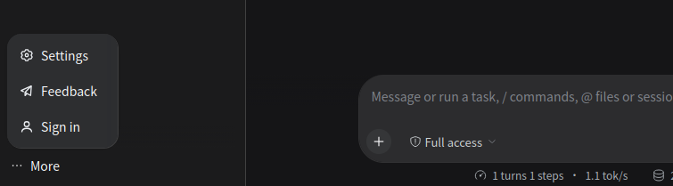
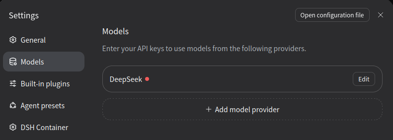

# Установка и настройка локального DeepSeek Harness с Ollama

Руководство запускает DeepSeek Harness (DSH) и Ollama в одной сети Docker Compose и подключает DSH к локальной модели.

## Перед началом

Нужны установленные Docker и Docker Compose, подключение к интернету для загрузки образов и модели, а также каталог `Projects` для проекта.

## Шаг 1. Создать каталог проекта

Создаём рабочий каталог и переходим в него:

```bash
mkdir -p Projects/dsh-local && cd Projects/dsh-local
```

## Шаг 2. Создать Compose-файл

Создаём файл конфигурации:

```bash
touch compose.yaml
```

Скопируйте в `compose.yaml` содержимое [примера](../examples/compose.yaml). В конфигурации важны следующие настройки:

- контейнеры взаимодействуют через внутреннюю сеть `ngm-llm-deepseek-harness-net`;
- порт DSH опубликован как `127.0.0.1:3080:3080`, поэтому интерфейс доступен только с хостовой машины;
- порт Ollama `11434` на хост не опубликован и доступен только другим контейнерам в сети `ngm-llm-deepseek-harness-net`;
- для доступа к DSH с других устройств необходимо изменить привязку порта и настроить `DSH_CONTAINER_KEY` и `DSH_CONTAINER_TRUSTED_HOSTS`;
- `DSH_CONTAINER_TRUSTED_HOSTS` определяет, каким именам хостов можно доверять. В примере разрешены `localhost`, `127.0.0.1` и `dsh`;
- рабочие файлы и настройки DSH сохраняются в именованных томах `ngm-llm-deepseek-harness-dsh-workspace` и `ngm-llm-deepseek-harness-dsh-data`;
- для DSH используется тег `latest`, поскольку образ не публикуется с версионным тегом. Зафиксированную версию Ollama можно обновлять отдельно после проверки примера.

## Шаг 3. Запустить Ollama и загрузить модель qwen3:8b

Запускаем сервис, скачиваем модель и проверяем список моделей:

```bash
docker compose up -d ollama
docker compose exec ollama ollama pull qwen3:8b
docker compose exec ollama ollama list
```

В списке должна появиться `qwen3:8b`; идентификатор и время будут отличаться:

```text
NAME                ID              SIZE      MODIFIED
qwen3:8b            500a1f067a9f    5.2 GB    46 minutes ago
```

## Шаг 4. Запустить контейнер DSH

Запускаем DSH в той же сети Compose:

```bash
docker compose up -d dsh
```

Открываем в браузере `http://localhost:3080` и проверяем работу интерфейса.

## Шаг 5. Настроить подключение DSH к Ollama

1. В интерфейсе DSH откройте раздел `Settings`.

   

2. В разделе `Models` выберите `+ Add model provider`.

   

3. В открывшемся окне выберите `Custom model API` и заполните поля:

   - `API key`: `ollama`. DSH требует непустой API-ключ для любого провайдера, но локальный сервер Ollama его не проверяет;
   - `Provider ID`: `ollama`;
   - `Display name`: `ollama`;
   - `Base URL`: `http://ollama:11434/v1`. Адрес работает внутри сети Compose; имя `ollama` недоступно с хостовой машины;
   - `API Protocol`: `OpenAI Chat Completions`.

4. Нажмите `Fetch available models`. В списке должна появиться загруженная модель. Выберите её и нажмите `Add selected`.

   

5. Завершите настройку кнопкой `Create provider`.

## Шаг 6. Проверить подключение

Создайте Workspace и сессию, выберите модель и отправьте тестовый запрос. Ответ модели подтвердит, что DSH подключён к Ollama.
