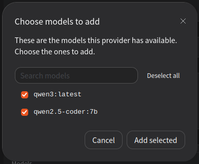

## Установка и настройка локального DeepSeek Harness, подключение к Ollama

Установим и настроим DeepSeek Harness (далее будет использовать сокращение DSH), подключим к модели, которая запускается с помощью Ollama.

Всё окружение будет функционировать в Docker - предполагается, что он уже установлен в системе.

Все наши проекты располагаются в каталоге `Projects`

### Шаг 1. Создадим папку проекта и перейдём в неё:

```bash
mkdir Projects/dsh-local && cd Projects/dsh-local
```

### Шаг 2. Создадим и настроим файл с описанием необходимых контейнеров

```bash
touch docker-compose.yml
```

В созданный `docker-compose.yml` скопируем содержание [файла](docker-compose.yml). На что необходимо обратить внимание в содержании файла:

- Взаимодействие контейнеров будет осуществляться по внутренней сети `dsh-net`. При этом для контейнера dsh будет "торчать наружу" порт 3080 - с хостовой машины к нему подключиться можно будет, но к контейнеру с Ollama по порту 11434 уже не получится;

- `ports: "127.0.0.1:3080:3080"` - порт DSH пробрасываем только на localhost. Для локальной работы - пойдёт, но если нужно будет подключаться с других устройств, придётся: а. заменить на `3080:3080`, b. настроить `DSH_CONTAINER_KEY` и `DSH_CONTAINER_TRUSTED_HOSTS`.

- `DSH_CONTAINER_TRUSTED_HOSTS` - крайне важная штука, т.к. определяет каким хостам можно доверять. В предложенном варианте настроен `dsh` и `localhost` чтобы не поймать 403 ошибку.

### Шаг 3. Запуск Ollama и загрузка модели qwen3:8b

```bash
docker compose up -d ollama
docker compose exec ollama ollama pull qwen3:8b
docker compose exec ollama ollama list
```

В результате должны увидеть что-то похожее на

```
NAME                ID              SIZE      MODIFIED       
qwen3:latest        500a1f067a9f    5.2 GB    46 minutes ago    
```

### Шаг 3. Запуск контейнера DSH

```bash
docker compose up -d dsh
```

Открываем браузер, переходим по адресу `http://localhost:3080` и проверяем.

### Шаг 4. Настраиваем подключение DSH к Ollama

- В интерфейсе DSH найти раздел `Settings` 

- В настройках найти раздел `Models` и выбрать пункт `+ Add model provider` 

- В открывшемся окне выбрать раздел `Custom model API` и заполнить поля:

    - `API key`: ollama. Тут нужно пояснение - DSH требует наличия API-ключа для любого провайдера, даже если локальный сервер llm его проверять не будет. Самое простое решение - ввести любое непустое значение в качестве ключа, Ollama просто проигнорирует его содержимое.

    - `Provider ID` и `Display name`: ollama

    - `Base URL`: http://ollama:11434/v1 (тут будет не лишним напомнить ещё раз - с хоста этот URL будет отдавать 404 ошибку, т.к. доступ к контейнеру с запущенной Ollama есть только у контейнера DSH)

    - `API Protocol`: `OpenAI Chat Completions`

    - `API key`: оставляем пустым

    - Жмём на кнопку "Fetch available models". Если всё настроено правильно, модель в контейнере ollama загружена - появится окно DSH с доступными моделями. Выбираем все (ну, или только нужные) и жмём `Add selected` 

    - Настройки завершены, жмём `Create provider`

### Шаг 5. Проверяем работу DSH с подключенной моделью

Создаём новый Workspace, новую сессию, выбираем модель, отправляем запрос, радуемся тому какие мы большие молодцы.